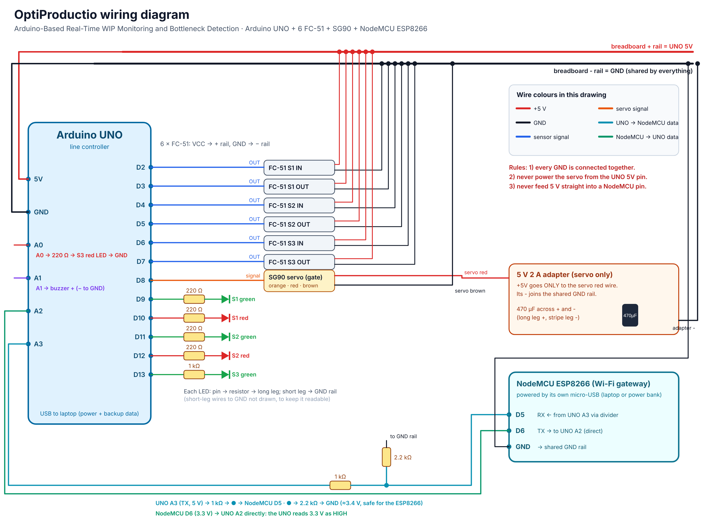

# OptiProductio wiring



(`wiring_diagram.svg` is the same drawing, zoomable. Regenerate with `python make_wiring_svg.py`.)

## Pin map (Arduino UNO)

| UNO pin | Goes to | Notes |
|---|---|---|
| 5V | breadboard **+ rail** | powers the 6 sensors only |
| GND | breadboard **− rail** | the shared GND: everything's minus ends up here |
| D2 | FC-51 **S1 IN** OUT pin | box arrives on Station 1 (released from the chute) |
| D3 | FC-51 **S1 OUT** OUT pin | box leaves Station 1 |
| D4 | FC-51 **S2 IN** | |
| D5 | FC-51 **S2 OUT** | |
| D6 | FC-51 **S3 IN** | |
| D7 | FC-51 **S3 OUT** | box leaves the line (finished) |
| D8 | SG90 **orange** (signal) | servo red → separate 5 V adapter +, servo brown → GND rail |
| D9 | 220 Ω → S1 green LED | long leg (+) to the resistor, short leg to GND |
| D10 | 220 Ω → S1 red LED | |
| D11 | 220 Ω → S2 green LED | |
| D12 | 220 Ω → S2 red LED | |
| D13 | **1 kΩ** → S3 green LED | the 6th LED gets the 1 kΩ (only five 220 Ω bought); it is a bit dimmer |
| A0 | 220 Ω → S3 red LED | |
| A1 | buzzer **+** | buzzer − to GND rail (active 5 V buzzer: it beeps by itself when given 5 V) |
| A2 | NodeMCU **D6** | NodeMCU → UNO data, direct wire (3.3 V is HIGH for the UNO) |
| A3 | **1 kΩ** → NodeMCU **D5**, and **2.2 kΩ** from D5 to GND | UNO → NodeMCU data through a voltage divider |
| A4, A5 | free | room for a button later |

## FC-51 sensor (3 pins)
VCC → + rail, GND → − rail, OUT → its UNO pin. OUT goes **LOW** when it sees a box, and the little LED on the module lights. The blue potentiometer sets the range: aim for 3 to 5 cm. Light-coloured boxes reflect better.

Mount the IN sensor at the entry edge of each platform and the OUT sensor at the exit edge, pointing across the path of the box, so a box passes in front of IN when it is placed and in front of OUT when it is pushed off.

## Servo power (important)
- The SG90 takes a current spike when it starts moving. From the UNO 5V pin, that spike can **reset the UNO** mid-demo.
- So: 5 V 2 A adapter **+** → servo red wire only. Adapter **−** → GND rail (shared with the UNO).
- 470 µF capacitor across the adapter's + and −, close to the servo. Long leg = +, the leg next to the stripe = −. Backwards electrolytic capacitors can pop.
- ELI5: the capacitor is a small **water tank** next to the tap. When the servo suddenly drinks, it drinks from the tank first instead of dropping the pressure for everyone.

## Voltage divider for UNO → NodeMCU
The UNO talks at 5 V, the ESP8266 at 3.3 V. 5 V into an ESP8266 pin can damage it.

```
UNO A3 ──[1 kΩ]──●── NodeMCU D5
                 │
              [2.2 kΩ]
                 │
                GND
```
Voltage at D5 = 5 × 2.2 / (1 + 2.2) ≈ **3.4 V**: HIGH for the ESP8266 and inside its limit.
ELI5: two resistors share the 5 V like two people sharing a pizza in the ratio of their sizes; the ESP8266 only eats the bigger share (2.2 out of 3.2 parts).

The other direction (NodeMCU D6 → UNO A2) needs no divider: the UNO reads anything above about 3 V as HIGH.

## Power
- UNO: USB cable from the laptop (also the backup data path).
- NodeMCU: its own micro-USB cable (laptop or power bank). Do not power it from the UNO's 3.3 V pin; it cannot supply the Wi-Fi current peaks.
- Servo: the 5 V 2 A adapter.
- **All GNDs connected**: UNO GND, NodeMCU GND, adapter −. Without a common GND, signals have no reference and act randomly.

## Wire length
20 cm jumpers do not reach across a 120 cm table. Keep the UNO and breadboard in the middle of the front strip and join one male-female + one male-male jumper for runs up to about 40 cm. Label both ends of every sensor wire with tape (S1 IN, S1 OUT, ...).
